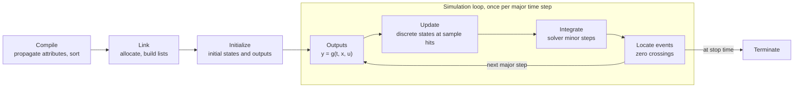
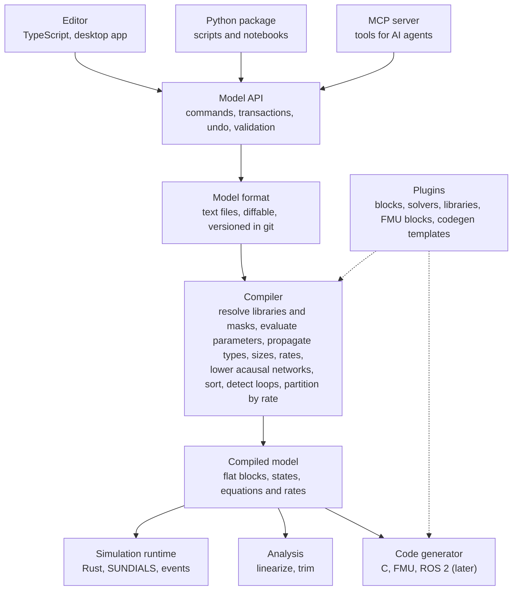
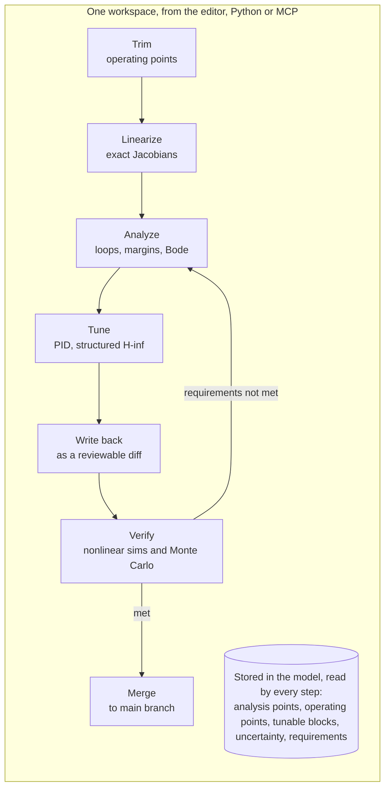

# SimuCraft: Research Findings

*Compiled 6 November 2026 for Django van der Plas. This file merges the market research doc, the pain points and opportunities doc, the decisions log, and new findings from the eleven papers in the Papers folder.*

Living versions of the first two parts: [Market research](https://claude.ai/artifact/8u5LheUcAXuWNSMtgDh5B3) · [Pain points and opportunities](https://claude.ai/artifact/6ksKBgTt39TYwTB3XK3e56)

## Contents

- [Executive summary](#executive-summary)
- [Decisions and requirements](#decisions-and-requirements)
- [Part A. Market research](#part-a-market-research)
- [Part B. Pain points and opportunities](#part-b-pain-points-and-opportunities)
- [Part C. Structured H-infinity tuning: what the papers say](#part-c-structured-h-infinity-tuning-what-the-papers-say)
- [Part D. Patent and license risks](#part-d-patent-and-license-risks)
- [Part E. Reproducible random numbers for Monte Carlo](#part-e-reproducible-random-numbers-for-monte-carlo)
- [Part F. Is more market research needed?](#part-f-is-more-market-research-needed)
- [Next steps](#next-steps)
- [Bibliography: papers on hand](#bibliography-papers-on-hand)
- [Sources](#sources)

## Executive summary

There is room for this project. No open-source tool combines a polished block-diagram editor, Python scripting, causal and acausal modeling in one diagram, and a path to embedded code under a permissive license.

- **Simulink's engine is reproducible.** It compiles a diagram into sorted lists of block methods (outputs, update, derivatives, zero crossings) and runs them in a solver-driven loop. The hard parts are corner cases: attribute propagation, multi-rate scheduling, algebraic loops and event location.
- **The closest open projects are code-first or narrow.** PathSim (with its PathView editor) and bdsim are active Python projects without acausal modeling. OpenModelica is acausal but not signal-flow first. Xcos is aging. Collimator's engine was archived in April 2025, and ModelingToolkit's acausal parts became AGPL in v11.
- **MCP support is table stakes.** MathWorks shipped an open-source MATLAB MCP Server and a Simulink Agentic Toolkit in 2026. The edge is being agent-native: a text model format and one API shared by editor, Python and MCP.
- **Your three priorities share one root cause.** Simulink keeps part of the work outside the model: data in the workspace, sweeps in scripts, tuning setups in app sessions. Putting everything a run depends on into plain text in the repository fixes parallel runs, version control and control design together.
- **Structured H-infinity tuning is fully published and implementable.** The papers describe the method end to end: a standard form, tunable parameterizations, requirements as normalized H-infinity and H2 constraints, and a nonsmooth solver. In 2014, systune tuned a fault-tolerant flight controller with 9 models, 11 states and 27 parameters in 30 seconds.
- **No permissive open implementation exists.** python-control only does full-order synthesis, PyGRANSO is AGPL, and Slycot is GPLv2, although SLICOT itself is now BSD-3. A solver has to be built.
- **New risk: patents.** MathWorks holds a US patent on this kind of tuning (US9158291B1, estimated expiry November 2032) and two related European patents. A freedom-to-operate review is needed before shipping structured tuning. It does not affect the MVP.
- **Reproducible Monte Carlo has a ready answer.** Counter-based generators such as Philox and Threefry give independent, replayable random streams per run, which is exactly what the experiment design needs.
- **Desk research is essentially complete.** The remaining gaps are a legal review and primary research: user interviews, and a block-usage analysis on the public SLNET corpus of 9,117 Simulink models to choose the MVP block library.

## Decisions and requirements

### Decisions so far

- **Modeling paradigm:** causal and acausal (Simscape-like) from the start.
- **Use case:** desktop simulation first; architecture ready for C code generation, HIL and ROS 2 later.
- **Interop priorities:** .slx import and hardware/ROS 2. FMU import recommended for v1.
- **Scale:** the model sizes Simulink handles, not a hobby subset.
- **Platform:** desktop first.
- **Team:** built by the project owner with AI assistance; open-source release after the MVP is usable. Recommended license: Apache-2.0.
- **Reference results:** the owner's Simulink student license can produce reference runs, once its terms are checked for this use.

### Core requirements added 6 November 2026

1. **Parallel runs and Monte Carlo are core:** experiment files, reproducible counter-based seeds, compile once and run many, local and cluster executors, an ensemble results store.
2. **Git and collaboration from day one:** the project as a directory of text files, stable IDs, layout apart from logic, an open semantic diff and three-way merge, pull-request diff rendering in CI.
3. **A unified control design workflow:** analysis points, operating points, tunable parameters, uncertainty and requirements stored in the model; one loop of trim, linearize, analyze, tune, write back and verify; structured H-infinity tuning as a key differentiator. The schema is in the MVP; the tools come after.

### Recommended stack

A text model format; a Rust engine with SUNDIALS behind a Python package; a pass-based compiler with an acausal stage; one compiled model feeding simulation, analysis and code generation; a TypeScript editor in a desktop shell; an MCP server on the same Model API.

## Part A. Market research

### A.1 How Simulink works

Simulink treats a diagram as a program: it compiles the diagram into sorted execution lists of block methods, then runs those lists in a time loop driven by a solver. Nearly everything else (subsystems, masks, libraries) is structure that disappears at compile time.

#### Origins

MathWorks released it in 1990 as SIMULAB and renamed it SIMULINK in 1992 ([Wikipedia](https://en.wikipedia.org/wiki/Simulink)). The founding paper already described the "open system" idea: blocks and analysis tools can be added, and every system is characterized by an S-function that can be written as a block diagram, C, Fortran or M-code ([Grace 1991](https://manuscript.isc.ac/Inventory/49/488848.htm)). That plugin-first design is the main thing worth copying.

#### The block model

Every block has inputs u, continuous states xc, discrete states xd, parameters and outputs y. Outputs are a function of time, inputs, states and parameters ([MathWorks: What is an S-function](https://www.mathworks.com/help//releases/R2021a/simulink/sfg/what-is-an-s-function.html)). A block provides up to five methods:

| Method | Computes | Called |
| --- | --- | --- |
| Outputs | y = g(t, x, u) | every major step, plus minor steps for continuous blocks |
| Update | next discrete state xd | once per major step, at the block's sample hits |
| Derivatives | dxc/dt | inside the solver's minor steps |
| Zero crossings | event functions that change sign at discontinuities | after each step, to locate events |
| Initialize / Terminate | sizes, sample times, memory | once |

A block also declares whether an output depends directly on its input in the same step (direct feedthrough). That flag is what lets the engine sort blocks and detect algebraic loops.

#### The three phases

1. **Compile.** Evaluate parameter expressions, propagate signal attributes (data type, dimensions, complexity, sample time) to blocks that left them unspecified, check port compatibility, flatten virtual subsystems, reduce blocks and sort them into an execution order ([MathWorks: Simulation phases](https://uk.mathworks.com/help/simulink/ug/simulating-dynamic-systems.html)).
2. **Link.** Allocate memory for signals, states and run-time parameters, store pointers to each block's buffers, and build one execution list per method type.
3. **Simulation loop.** At each major step: compute outputs, update discrete states, integrate continuous states (the solver may call Outputs and Derivatives many times in minor steps), check for zero crossings, then compute the next time step.



Compile, link and initialize run once; the loop repeats every major step, and the solver takes its minor steps inside Integrate.

#### Sample times and multi-rate

A block runs only at its sample hits, so a 1 s block is skipped on most steps of a 0.1 s base rate. In multitasking mode the execution lists are split by rate into separate tasks, which is what real-time targets run; variable-step solvers are in practice used only in single-tasking mode ([US patent 7412367](https://image-ppubs.uspto.gov/dirsearch-public/print/downloadPdf/7412367)). Rate Transition blocks handle data crossing between rates deterministically.

#### Solvers, events and loops

- **Solvers.** Variable-step is the default; fixed-step is required for code generation and real time ([MathWorks: Configure simulation](https://www.mathworks.com/help/simulink/configure-simulation.html)). Since R2026b, Simulink also lets users register their own fixed- or variable-step solvers through a plugin API ([MathWorks](https://ch.mathworks.com/help/simulink/configure-simulation.html)).
- **Zero crossings.** Blocks such as Saturation, Switch and Integrator register event functions. When one changes sign, the engine brackets the crossing time and steps exactly to it, instead of shrinking every step ([MathWorks archive](https://atmos.washington.edu/~brodzik/for_yuter/20050614_opt/matlab6/help/toolbox/simulink/ug/how_si14.html)). An adaptive variant tolerates chattering around zero ([MathWorks: Algorithm](https://au.mathworks.com/help/simulink/gui/algorithm.html)).
- **Algebraic loops.** A feedback path made only of direct-feedthrough blocks forms an algebraic equation. Simulink solves it every step with a Newton-type loop solver, which may fail without a good initial guess ([US patent 8667462](https://image-ppubs.uspto.gov/dirsearch-public/print/downloadPdf/8667462)).

#### Structure features

- **Subsystems.** Virtual subsystems are only visual grouping and vanish at compile; atomic (nonvirtual) ones execute as a unit and become functions in generated code.
- **Masks.** A parameter dialog, icon and initialization code on top of a subsystem, turning it into a reusable custom block.
- **Libraries.** Blocks in a model link back to a library, so fixing the library updates every user.
- **Model reference, variants, buses and data dictionaries.** Separate files compiled independently, design alternatives selected by a control variable, structured signals, and parameter and type definitions stored outside the model ([MathWorks: Data dictionary for libraries](https://www.mathworks.com/help/simulink/ug/link-data-dictionary-to-custom-libraries.html)).

#### File format

An .slx file is a compressed package following the Open Packaging Conventions, storing model information as UTF-8 XML ([MathWorks: Save models](https://mathworks.com/help/simulink/ug/save-models.html)). It arrived in R2012a, became the default in R2012b, and keeps most of the model in simulink/blockdiagram.xml; it is not documented ([Stack Overflow archive](https://kiwix.lema.org/stackoverflow.com_en_all_2023-11/questions/23408186/information-about-simulink-mdl-and-slx-formats)).

#### Simscape, the acausal layer

Simscape runs a separate pipeline inside Simulink: validate the physical network, build its equations, compute initial conditions, then solve transiently, re-initializing after events ([MathWorks: How Simscape simulation works](https://kr.mathworks.com/help/simscape/ug/how-simscape-simulation-works.html)). Each physical network needs one Solver Configuration block, which sets index reduction and optionally a local fixed-step solver ([MathWorks: Solver Configuration](https://kr.mathworks.com/help/simscape/ref/solverconfiguration.html)). Network equations are solved simultaneously while Simulink blocks run sequentially, so converter blocks mark the boundary and carry units ([MathWorks: Essential steps](https://ch.mathworks.com/help/simscape/gs/essential-steps-for-constructing-a-physical-model.html)).

#### Code generation

Simulink Coder writes the compiled model to an intermediate file, model.rtw, that mirrors the diagram as nested records. The Target Language Compiler then runs one target file per block type plus model-wide system files to produce model.c, model.h and supporting files ([MathWorks: TLC overview](https://de.mathworks.com/help/rtw/tlc/target-language-compiler-overview.html)). The lesson: code generation reuses the compiler's output, not the editor's model.

#### What this means for your architecture

| Simulink concept | Design decision it implies |
| --- | --- |
| Block methods and the S-function API | One block contract for built-in and plugin blocks, from day one |
| Compile-time attribute propagation | A pass-based compiler with good error messages, not ad-hoc checks |
| Sorted, per-method execution lists | A flat, compiled model representation separate from the diagram |
| Sample hits and rate-split tasks | Rates are first-class in the compiled model, ready for real time |
| model.rtw feeding TLC | Simulation and code generation consume the same compiled model |
| Simscape networks with converter blocks | An acausal compiler that lowers networks to equations next to causal blocks |

### A.2 What makes Simulink so usable

Simulink's usability comes less from any single feature than from hiding the numerics while keeping the engineer's mental model on screen. These are the traits an alternative has to match, grouped by what they save the user from.

| Trait | What the user gets | How Simulink does it |
| --- | --- | --- |
| The diagram is the math | The textbook block diagram is the executable model | Signal-flow semantics, transfer function and state-space blocks |
| Hierarchy you can trust | Break physics into submodules and reuse them | Subsystems, masks, libraries with links, model reference |
| Inference over declaration | Little boilerplate on types, sizes and rates | Compile-time propagation of data types, dimensions and sample times |
| Solvers out of the way | Good results without tuning, with help when it fails | Auto solver selection, zero crossings, Solver Profiler and Zero Crossing Explorer ([MathWorks](https://www.mathworks.com/help/simulink/configure-simulation.html)) |
| Instant feedback | See signals while iterating | Scopes, displays, signal logging, Simulation Data Inspector |
| Language next to the diagram | Parameters, sweeps and post-processing in code | Workspace variables as parameters, sim(), SimulationInput, parsim ([MathWorks](https://cs400-web.cs.wisc.edu/nchou/s/matlab-2020b/amd64_ubu22/amd64_rhel6/help/simulink/slref/parsim.html)) |
| Fast iteration loops | Re-run without recompiling | Fast Restart keeps the compiled model and allows tunable parameter changes ([MathWorks](https://mathworks.com/help/simulink/ug/fast-restart-workflow.html)) |
| Escape hatches at every level | Never stuck when a block is missing | MATLAB Function block, S-functions in MATLAB or C |
| One model from desktop to target | Simulation and embedded code stay in sync | Fixed-step configuration, Simulink Coder, external mode |
| Analysis built in | Control design without leaving the model | Linearization and trim on the compiled model |

#### Pain points an open tool can win on

The open projects reviewed here are explicit about what they react against, and these are the gaps worth designing for:

- **Diffing and merging.** bdsim pitches text models over "opaque binary blobs" so models can be versioned and reviewed ([bdsim](https://github.com/petercorke/bdsim)).
- **Cost and lock-in.** Every reviewer and tester needs a seat. Simbind exists because test teams want Simulink models in Python without extra licenses ([Simbind thread](https://redlib.hbubli.cc/r/matlab/comments/1ajzibh/transform_simulink_model_into_python_package)).
- **Closed semantics.** Researchers had to reverse-engineer an operational semantics for Simulink's engine because none is published ([Bouissou & Chapoutot 2012](https://perso.ensta-paris.fr/~chapoutot/recherche/lctes12_bc.pdf)). Documented semantics is a selling point for verification and teaching.
- **Python ecosystem access.** Wires in bdsim carry any Python object, and SciPy, PyTorch or vision pipelines plug straight in.

You rated all of these traits as important and added three priorities of your own: parallel runs, version control and control design. Part B covers them.

### A.3 Prior attempts and alternatives

The field splits into Python libraries that are code-first and causal-only, Modelica and Julia tools that are acausal but not built around signal flow, and commercial tools that already mix both. No open project covers the combination you want.

| Project | Kind | License | Status (Nov 2026) | What it gets right | What it lacks for your goal |
| --- | --- | --- | --- | --- | --- |
| [PathSim](https://pypi.org/project/pathsim/0.23.2/) + [PathView](https://dev.to/milan_rother/i-built-an-open-source-simulink-alternative-that-runs-in-your-browser-4gpg) | Python library + browser editor | MIT | Very active: v0.30.2 released Nov 5, 2026; one maintainer | Stiff solvers, zero crossings, subsystems, editor running Python in the browser via Pyodide | No acausal modeling; each block integrates itself rather than one global solver ([PathSim](https://pypi.org/project/pathsim)); no embedded code generation found |
| [bdsim](https://github.com/petercorke/bdsim) | Python library + bdedit editor | Open source | Active; real-time branch planned for end of 2026 ([wiki](https://github.com/petercorke/bdsim/wiki/Graphics-blocks/.bd-files)) | Diagrams as plain Python, any Python object on wires, robotics toolboxes | SciPy solvers without event handling ([JOSS paper](https://www.theoj.org/joss-papers/joss.08158/10.21105.joss.08158.pdf)); editor is secondary |
| [pycollimator](https://pypi.org/project/pycollimator/) | JAX engine for a cloud product | MIT from v2.2.0 (was AGPL) | Archived April 8, 2025 | Differentiable JAX simulation, MPC blocks, a web GUI | Product discontinued; shows the risk of a cloud-first business model |
| [SimuPy](https://pypi.org/project/simupy/0.1.0.dev5/) | Python library | Open source | Dormant | Symbolic model definition with SymPy | Small scope, no editor |
| [Xcos / Scicos](https://help.scilab.org/xcos) | Editor + hybrid simulator in Scilab | Open source | Maintained by Dassault Systèmes; Scilab 2026.1 | Mature hybrid engine, Modelica blocks, code generation | Tied to the Scilab language; small community |
| [OpenModelica](https://script.spoken-tutorial.org/index.php/OpenModelica) | Modelica compiler + OMEdit | Open source | Mature | Acausal multi-domain modeling, Modelica Standard Library, FMI | Equation language first; control workflows feel indirect |
| [ModelingToolkit](https://sciml.ai/news/2026/07/27/ModelingToolkitv11/index.html) / [Dyad](https://research.tedneward.com/languages/dyad.html) | Julia acausal compiler / commercial GUI | Base MIT, acausal extensions AGPL since v11 | Active; Dyad pairs block diagrams with acausal models and generates C ([JuliaCon 2026](https://pretalx.com/juliacon-2026/speaker/9YRTNA/)) | The strongest open acausal compiler (tearing, high-index DAEs) | Julia, not Python; AGPL on the parts you would need |
| [Altair Activate](https://altairengineering.fr/activate) | Commercial editor | Proprietary (free Basic edition since 2018) | Altair is now part of Siemens | Signal blocks and Modelica components in one diagram, FMI, code generation | Closed source |
| [DAE Tools](https://daetools.sourceforge.io/docs/pyDAE_user_guide.html) | C++ core with Python modeling | Open source | Niche | Acausal equations written in Python, SUNDIALS IDAS | No block diagram editor |

#### Lessons from the field

- **Simulink translators only ever reached a subset.** Inria's OpenCPS translator targeted selected blocks because block semantics are ambiguous and depend on proprietary solvers ([OpenCPS D5.8](https://itea4.org/index.php/project/workpackage/document/download/4252/D5.8.%20OPENCPS%20-%20Simulink%20To%20Modelica%20Importer%20.pdf)). Claytex's Simelica and a Scilab GSoC project took the same route ([Dempsey 2003](https://modelica.org/events/Conference2003/papers/h42_Dempsey.pdf), [Scilab wiki](https://wiki.scilab.org/Contributor%20-%20Simulink%20Import)).
- **Mixed causal and acausal diagrams are proven.** Activate, Dyad and Modelica itself all mix the two in one model ([Modelica by Example](https://mbe.modelica.university/components/components/block_comps)), so the question is execution, not feasibility.
- **Licensing shapes adoption.** Collimator moved from AGPL to MIT just before archiving, and ModelingToolkit's AGPL split drew a long community debate ([Julia Discourse](https://discourse.julialang.org/t/modelingtoolkit-v11-library-split-and-licensing-community-feedback-requested/134396)). Decide your license early.
- **PathSim is a potential partner as much as a competitor.** It has momentum and a browser editor; talking to its maintainer before building a second causal engine is worth an email.

### A.4 Interoperability

FMU import is the cheapest way to get physical models into your tool early, .slx import should be a migration aid rather than a compatibility promise, and ROS 2 support needs the engine to run against wall-clock time.

#### FMI and FMUs

FMI is the open standard for exchanging simulation models; an FMU is a zip with compiled C code plus an XML description of its variables. FMI 2.0 was supported by more than 160 tools when FMI 3.0 was presented in 2021 ([Modelica 2021 proceedings](https://2021.international.conference.modelica.org/proceedings/authors/MasoudNajafi)). An FMU comes in up to three interface types:

| Interface type | What the FMU exposes | Fit in your tool |
| --- | --- | --- |
| Model Exchange | Equations only; your solver integrates them | Becomes a block with continuous states in your global solver |
| Co-Simulation | Its own solver; you call doStep | Becomes a discrete block at a communication step |
| Scheduled Execution (3.0) | Model partitions activated by an external scheduler, RTOS-like | Later, for virtual ECUs and real-time |

FMI 3.0 also adds clocks for synchronizing events, array variables, a binary type for sensor data, event mode in co-simulation, and terminals and icons that describe buses and physical connectors ([FMI FAQ](https://fmi-standard.org/faq/)). Terminals matter for you: they let an imported FMU show up with proper physical ports.

Recommendation: FMU import (Model Exchange and Co-Simulation) in version 1, FMU export once the code generator exists. This also gives you Modelica, Simscape and vendor models in your diagrams long before your own acausal library is large.

#### .slx import

Reading the structure is straightforward: unzip, parse simulink/blockdiagram.xml, map blocks and lines. Reproducing behavior is not, because parameters are stored as strings, often MATLAB expressions referencing workspace variables, and the format changes between releases. Two routes, best used together:

1. **File importer.** Parse the XML, map each BlockType through a versioned mapping table, keep unknown blocks as placeholders with their original parameters, and report what was not converted.
2. **MATLAB-side exporter.** A small MATLAB script that walks a loaded model with the official API (find\_system, get\_param) and writes your format. It sees compiled values and resolved library links, so it is far more reliable. Anyone migrating still has a Simulink license.

Your license helps here: reference simulations run in Simulink make a conformance test suite for each block. Check the MathWorks license terms on using Simulink output while developing a competing product before relying on this.

#### ROS 2 and hardware

MathWorks' pattern is a good template: Publish, Subscribe, service and action blocks for desktop simulation, generation of a standalone ROS 2 node in C++ built with colcon, external mode for live tuning, and support for the /clock topic as simulation time ([MathWorks: ROS 2 in Simulink](https://ww2.mathworks.cn/help/ros/ros2-in-simulink.html), [ROS Toolbox](https://uk.mathworks.com/products/ros.html)).

For your tool this splits into two stages:

- **Desktop co-simulation (early).** Blocks backed by rclpy or rclcpp that publish and subscribe while the model runs in paced real-time mode or follows /clock from Gazebo. This needs an engine that can pace to wall-clock time and accept asynchronous inputs.
- **Deployment (with code generation).** Generate a ROS 2 node or a bare-metal target from the fixed-step compiled model, plus an external-mode protocol that streams signals and accepts parameter changes from the editor.

The same "external mode" protocol serves HIL rigs, microcontroller targets and, later, a Simulink Real-Time equivalent, so it is worth designing once.

### A.5 Core features and future features

The MVP should match base Simulink plus a small acausal library, an MCP server and a plugin SDK; everything later must already have a hook in the architecture, even if it ships years later. The last column is the point of the table: it names the decision you make now so the later feature does not force a rewrite.

| Feature | Phase | Scope | Architecture hook needed from day one |
| --- | --- | --- | --- |
| Canvas editor | MVP | Library browser, drag and drop, auto-routed wires, branches, undo, annotations | Every edit is a command on one Model API, shared by editor, Python and MCP |
| Text model format | MVP | Diffable, schema-versioned, layout stored apart from logic | One source of truth; a migration step per schema version |
| Subsystems | MVP | Virtual and atomic, port blocks, enabled and triggered subsystems | Compiler flattens virtual ones and keeps atomic ones as units for code generation |
| Masks | MVP | Parameter dialogs, icons, initialization code in Python | A mask is metadata plus a Python init hook, nothing special in the engine |
| Libraries with links | MVP | Linked copies that update from the library | Blocks reference library ID and version in the model file |
| Compile passes | MVP | Parameter evaluation; type, size and sample-time propagation; sorting; loop detection | A pass pipeline that emits structured diagnostics tied to block IDs |
| Solvers | MVP | Variable-step (Dormand-Prince, CVODE BDF), fixed-step (Euler, RK4), IDA for DAEs | A solver plugin interface, as Simulink itself added in R2026b |
| Zero crossings | MVP | Saturation, Switch, Relay, Integrator limits and resets | Event functions are part of the block contract |
| Multi-rate discrete | MVP | Sample hits, inherited sample times, Rate Transition, single-tasking | Rates are explicit in the compiled model, ready for multitasking later |
| Algebraic loops | MVP | Newton solve with initial guess; diagnostics that highlight the loop | Direct-feedthrough flags in every block |
| Acausal networks | MVP | Electrical, 1D translational and rotational, thermal; converter blocks | An acausal compiler that lowers networks to equations beside causal blocks |
| Base block library | MVP | Sources, sinks, continuous, discrete, math, nonlinear, lookup tables, logic, routing, buses | Each block passes a conformance test against Simulink reference results |
| Python Function block | MVP | The MATLAB Function block equivalent | Runs as a callback now; JIT or code generation later behind the same contract |
| Python API | MVP | Build, edit, run and sweep models; results as NumPy and pandas | The same Model API as the editor, not a separate scripting layer |
| Scopes and logging | MVP | Live scopes, signal logging, compare runs | Logging is a stream the editor, Python and MCP all subscribe to |
| MCP server | MVP | Read, edit, compile, simulate, query signals | A thin adapter over the Model API, so agents get every capability for free |
| Plugin SDK | MVP | Block libraries as pip packages; native blocks in Rust or C | Stable block contract and ABI; versioned plugin metadata |
| Fast restart and sweeps | v1 | Re-run without recompiling; parallel parameter sweeps | Tunable parameters kept separate from structural ones |
| FMU import | v1 | Model Exchange and Co-Simulation, FMI 2.0 and 3.0 | An FMU is just another block implementing the contract |
| .slx migration | v1 | XML importer plus MATLAB-side exporter, block mapping table | Unknown-block placeholders that keep original parameters |
| Linearization and trim | v1 | Operating points, state-space output for python-control | Jacobians available from the compiled model |
| Model reference and variants | v1 | Separate model files, design alternatives | Compile units and a variant control in the model format |
| ROS 2 co-simulation | v1 | Publish and Subscribe blocks, paced real time, /clock | Engine can pace to wall-clock time and take asynchronous input |
| State machines | Later | A Stateflow-like chart block | Charts compile to the same block contract |
| C code generation | Later | Fixed-step models to portable C, per-block templates | Simulation and codegen consume one compiled model |
| FMU export | Later | Models as FMI 3.0 FMUs | Built on the C generator |
| ROS 2 node generation | Later | Standalone nodes, colcon build | Built on the C generator plus the external-mode protocol |
| Real time and HIL | Later | Multitasking scheduler, external mode, target support packages | Deterministic scheduler and a signal and parameter streaming protocol |
| Fixed-point and integer types | Later | Embedded data types and scaling | Data types are part of signals in the model format from the MVP |
| Toolboxes | Later | Control design, signal processing, differentiable simulation | Delivered as plugins on the same SDK |

### A.6 Architecture and tech stack

Recommended stack: a text model format as the single source of truth, a Rust simulation core with SUNDIALS solvers exposed through a Python package, a pass-based compiler (including an acausal stage) that emits one compiled model for both simulation and code generation, and a TypeScript editor shipped as a desktop app. The editor, the Python API and the MCP server are three front ends on the same Model API.

#### The layers

1. **Model format.** Plain text (JSON or a small TOML/YAML schema), versioned, with layout stored apart from logic so diffs stay readable. Libraries, masks and parameters are references, not copies.
2. **Model API.** Every change is a command (add block, connect, set parameter) inside an undoable transaction. The editor, Python scripts and AI agents all go through it, which is what makes undo, collaboration and MCP cheap.
3. **Compiler.** A pipeline of passes: resolve libraries and masks, evaluate parameters in Python, propagate types, sizes, units and sample times, lower acausal networks to equations, sort, detect algebraic loops, partition by rate. Every pass emits diagnostics tied to block IDs.
4. **Compiled model.** A flat, serializable representation of blocks, states, rates and equations, the equivalent of Simulink's model.rtw. Simulation, linearization, FMU export and C code generation all read this, never the diagram.
5. **Runtime.** Scheduler, solvers, zero-crossing location, logging streams and pacing to wall-clock time. Built-in blocks run natively; Python blocks run as callbacks.
6. **Front ends.** The editor, the Python package and the MCP server.



The two highlighted layers are the decisions that matter most: one API for all front ends, and one compiled model for all back ends. Plugins hook into the compiler and the code generator, and their blocks run in the runtime through the compiled model.

#### Why these choices

| Decision | Recommendation | Main alternative | Why |
| --- | --- | --- | --- |
| Core language | Rust, with Python bindings via PyO3 | C++ with pybind11 | Memory safety in a large engine, easy packaging of wheels, compiles to WebAssembly for a browser version. C++ is equally valid if your contributors know it better |
| Solvers | SUNDIALS (CVODE, IDA, ARKODE) plus own fixed-step methods | SciPy integrators | SUNDIALS is BSD-3 and covers stiff ODEs and DAEs ([sundials4py](https://pypi.org/project/sundials4py/7.7.0/)); SciPy has no DAE solver and calls back into Python each step |
| Pure Python engine | No, but keep a Python reference engine for tests | PathSim and bdsim style | Per-block Python calls in every minor step limit model size; pure Python is fine for teaching-size models |
| Acausal compiler | Own symbolic stage (alias elimination, tearing, index reduction) over your own equation IR | Reuse ModelingToolkit or OpenModelica | MTK's acausal parts are AGPL since v11 ([SciML](https://sciml.ai/news/2026/07/27/ModelingToolkitv11/index.html)); OpenModelica is a separate compiler. Prototype with CasADi, which imports FMI 3.0 FMUs and generates C ([CasADi releases](https://github.com/casadi/casadi/releases?page=2)) |
| Editor | TypeScript canvas app in a desktop shell (Tauri or Electron), talking to the engine over a local socket | Qt desktop app | Web UI tech has the richest diagram tooling and can also run in a browser, as PathView shows with Pyodide |
| Project license | Apache-2.0 or MIT for the core | AGPL or GPL | The two license moves in Section A.3 show permissive licensing is what attracts companies and contributors; Apache-2.0 adds a patent grant |

#### Plugin contract

One block contract for built-in blocks, plugins and FMUs, modeled on the S-function callbacks:

- **Declare:** ports, sizes, data types, sample time, direct-feedthrough flags, parameters (tunable or structural), mask UI.
- **Execute:** outputs, update, derivatives, zero-crossing functions, initialize and terminate.
- **Optional:** a symbolic form (for linearization and the acausal compiler), a code-generation template, and an icon.
- **Distribute:** a pip-installable package registered through Python entry points, with native blocks in Rust or C behind a stable ABI.

Acausal components use a second, equation-based contract: connectors with across and through variables plus equations, the way Simscape and Modelica components are written.

#### MCP and agents

MathWorks' toolkit exposes tools to read model structure, edit blocks and connections, query parameters and run simulations ([MathWorks](https://www.mathworks.com/campaigns/offers/next/agentic-ai-with-matlab.html)). Match that set, then go further where an open, text-based tool has the advantage:

- Compile diagnostics as structured data (block ID, pass, message, suggested fix), so an agent can repair a model.
- Signals returned as summaries or downsampled arrays, not raw dumps, to keep agent context small.
- A dry-run mode that shows the diff an edit would make before it applies.
- Library documentation served as MCP resources, so agents pick the right block.

Because the MCP server wraps the same Model API, any feature you add to the editor is available to agents without extra work.

## Part B. Pain points and opportunities

All three of your priorities are real, well-documented pain points. In Simulink, the model, its data and its analysis setup live in different places: a zipped file, the MATLAB workspace and app sessions. Making everything a run depends on plain text in the repository addresses all three. Two synergies are worth designing for: gain scheduling and robustness checks are parallel experiments over operating points or uncertain parameters, and the same uncertain-parameter declarations feed both Monte Carlo and robust control.

### B.1 Parallel runs and Monte Carlo

Make the experiment, not the single simulation, the engine's unit of work. Simulink added parallel runs to a tool built around one interactive simulation, and most of the friction comes from that.

#### How Simulink does it today

Each run is a SimulationInput object that overrides variables, block parameters or model settings; sim, parsim and batchsim run arrays of them, optionally with Fast Restart to skip recompilation ([parsim](https://cs400-web.cs.wisc.edu/nchou/s/matlab-2020b/amd64_ubu22/amd64_rhel6/help/simulink/slref/parsim.html), [Fast Restart](https://mathworks.com/help/simulink/ug/fast-restart-workflow.html)). Without Parallel Computing Toolbox or MATLAB Parallel Server, parsim runs the simulations serially ([MathWorks example](https://ch.mathworks.com/help/simulink/slref/parallel-simulations-using-parsim-parameter-sweep-in-normal-mode.html)).

#### Where it hurts

| Pain | Evidence | Root cause |
| --- | --- | --- |
| Workers cannot see base-workspace variables; runs fail with "variable does not exist" until TransferBaseWorkspaceVariables is set | [MATLAB Answers](https://se.mathworks.com/matlabcentral/answers/1812600-error-with-parsim-while-changing-variables) | Model data lives outside the model |
| Random numbers repeat across parallel Fast Restart runs; the accepted fix feeds seeds in through a Constant block | [MATLAB Answers](https://www.mathworks.com/matlabcentral/answers/1450814-random-generator-seed-for-parallel-simulation-using-fast-restart) | Randomness is block state, not part of the run definition |
| Logging overrides were ignored under Fast Restart in R2021b, fixed in R2022b | [MATLAB Answers](https://uk.mathworks.com/matlabcentral/answers/1627405-log-a-subset-of-signals-using-fast-restart) | Run settings and compiled state interact in subtle ways |
| Each worker loads the model and sets up its own cache folder before running | [MathWorks example](https://ch.mathworks.com/help/simulink/slref/parallel-simulations-using-parsim-parameter-sweep-in-normal-mode.html) | Workers are full MATLAB sessions |
| Parallel execution is a separate paid toolbox, and clusters need another product | same | Licensing |
| Experiments are scripts, not artifacts: the sweep definition is not versioned with the model | general practice | No experiment object in the model |

#### What to build in from day one

- **Experiment files in the repository.** An experiment names a model, parameter overrides, distributions (normal, uniform, tabulated), a sampling plan (grid, Monte Carlo, Latin hypercube, Sobol), the number of runs, a seed, what to record and pass/fail criteria. It is diffable and reviewable like the model.
- **Reproducible randomness by construction.** Derive every random stream from (experiment seed, run index, block ID) with a counter-based generator such as Philox (see Part E). Any run gives the same result whatever the worker count or order, and run 4711 can be replayed alone with full logging.
- **Compile once, run many.** The compiled model is immutable and shared; each run only carries its state vector and tunable-parameter vector. Because parameters live in the model files, there is no workspace to transfer.
- **One API, several executors.** Threads inside the Rust engine, a local process pool for models with Python blocks, then Dask, Ray or Slurm for clusters.
- **Results built for ensembles.** Compute metrics on the worker, stream results to a columnar store (Parquet or Zarr), keep full traces only where asked (all, a sample, or failures). The editor shows envelopes and histograms, and a click on an outlier re-runs that case with scopes open.
- **Later:** batched execution of many parameter sets in one vectorized integration, adaptive stopping when statistics converge, and rare-event methods such as importance sampling.

A sketch of the Python side, for an aerospace dispersion campaign:

```python
exp = Experiment("lander.sim", runs=2000, seed=42)
exp.vary("vehicle.mass", Normal(1200, 25))
exp.vary("engine.thrust_bias", Uniform(-0.02, 0.02))
exp.record(metrics={"touchdown_vz": final("vz")}, traces="failures")
exp.require("touchdown_vz > -2.0")
res = exp.run(workers=16)
res.metrics.describe()
res.replay(res.failures[0])   # same seed, full logging
```

### B.2 Version control and collaboration

This is the most achievable big win: store models as text that Git understands natively, and ship an open semantic diff and merge tool that needs nothing but a pip install.

#### How Simulink does it today

A Git merge driver (mlAutoMerge) combines branches that changed different subsystems, Stateflow charts or configuration sets; conflicts open in a Three-Way Merge tool, and a Source Control panel with "View Conflicts" arrived in R2025a ([MathWorks blog](https://blogs.mathworks.com/simulink/2025/06/30/merging-simulink-models-automatically-in-git/), [MathWorks docs](https://www.mathworks.com/help/simulink/ug/diff-and-merge-tools-continuous-integration.html)). CI pipelines can generate diff reports and attach them to pull requests.

#### Where it still hurts

- **Git sees a binary file.** .slx is marked binary in .gitattributes; plain Git, GitHub and GitLab show no diff, and Git reports "Cannot merge binary files" without the MathWorks driver ([MathWorks blog](https://blogs.mathworks.com/simulink/2025/06/30/merging-simulink-models-automatically-in-git/)).
- **Every step needs MATLAB.** Merging, diff reports and conflict resolution run in MATLAB; conflicts are resolved locally in the Three-Way Merge tool, not in the pipeline ([MathWorks docs](https://www.mathworks.com/help/simulink/ug/diff-and-merge-tools-continuous-integration.html)). A reviewer without a license sees nothing.
- **Auto-merge is coarse.** It works best when changes are in different subsystems; two branches adding the same kind of block at the top level conflict ([MathWorks blog](https://blogs.mathworks.com/simulink/2025/06/30/merging-simulink-models-automatically-in-git/)).
- **Teams work around it with process.** A team of about 12 editing shared models relies on ownership rules: "If everyone is allowed to touch everything it will be a big mess in no time" ([MATLAB Answers](https://www.mathworks.com/matlabcentral/answers/1927790-recommended-practises-for-using-git-when-collaborating-using-matlab-simulink)).
- **Zipped source is the wrong default.** Michael Tiller argues models should be saved as directories of text files, with archives only for distribution, and without "last saved" metadata that causes spurious conflicts ([Tiller](https://whiteboard.modelica.university/blog/dont-zip/)).
- **Release lock-in.** A model saved in a newer release does not open in an older one until someone exports it to the previous version ([MATLAB Answers](https://uk.mathworks.com/matlabcentral/answers/94724-how-can-i-open-my-current-simulink-models-in-previous-versions-of-simulink)), so a whole team must upgrade together.

#### What to build in from day one

- **A project is a directory of text files.** One file per subsystem or model unit, so a diff points to the part that changed and CODEOWNERS maps ownership onto the model's structure.
- **Stable IDs and deterministic output.** Every block, port and connection gets a permanent ID; files are written in a fixed order and format, so saving an unchanged model changes nothing. No timestamps or user names in source files.
- **Layout apart from logic.** Positions and wire routes go in a separate section or file, so tidying a diagram never conflicts with a parameter change.
- **An open semantic diff and merge engine.** It compares models by ID and conflicts only on true overlaps, such as the same parameter changed twice. It ships as a Python library, a Git merge driver, a CLI, and part of the editor and MCP server.
- **Reviews where people already review.** A CI action posts a before/after diagram with changes highlighted plus a text summary on every pull request, readable without installing anything.
- **Versioned libraries and a lock file,** so a checkout reproduces the exact model.
- **A forward-compatible format:** a schema version with automatic migrations; older versions open newer files with a warning about unknown fields.
- **Later:** live co-editing on the Model API's command stream, and review comments anchored to block IDs.

This also makes AI agents safer to use: an agent edits on a branch, and a human reviews a readable diff before merging.

### B.3 Control design workflow

Turn control design from a set of apps into one loop whose whole setup is stored in the model. Structured H-infinity tuning is the hardest single piece; Part C covers it in depth.

#### How Simulink does it today

Simulink Control Design alone offers six apps: Steady State Manager, Model Linearizer, Linearization Advisor, PID Tuner, Control System Designer and Control System Tuner ([MathWorks](https://www.mathworks.com/products/simcontrol.html)). Scripted tuning goes through an slTuner object: list the tuned blocks, add analysis points, define TuningGoal objects, run systune, then call writeBlockValue to push values back and re-run the nonlinear simulation ([MathWorks](https://www.mathworks.com/help/control/ug/tuning-control-systems-in-simulink.html)). systune and looptune come with Control System Toolbox, hinfstruct with Robust Control Toolbox, and Simulink use needs Simulink Control Design ([MathWorks](https://www.mathworks.com/help/robust/gs/difference-between-fixed-structure-tuning-and-traditional-h-infinity-synthesis.html)).

#### Where it hurts

- **Fragmented tools.** Six apps and three products, each with its own session state.
- **The design lives outside the model.** Tuned blocks, extra analysis points and goals are MATLAB objects in a script or app session, not reviewed or versioned with the controller they produced.
- **Write-back is manual.** Tuned values are copied into the model by a separate call, then verified by a separate simulation.
- **Gain scheduling is orchestration.** Seven steps and about eight tools, ending with simulation because "local linear performance does not guarantee global performance" ([MathWorks](https://www.mathworks.com/help/control/ug/tune-gain-schedules-in-simulink-1.html)).
- **No permissive open alternative for structured tuning** (details in Part C).

#### What to build



For gain scheduling, Trim and Linearize run once per operating point in parallel on the experiment engine; Verify reuses the same requirements as pass/fail checks.

- **Design metadata in the model.** Analysis points and loop openings on any signal; operating-point specifications; tunable parameters with their parameterization (PID form, fixed-order transfer function, gain surface over scheduling variables); uncertain parameters with ranges or distributions; requirements such as step tracking, margins, sensitivity bounds and pole regions. All text, all diffable.
- **Exact linearization.** Jacobians from the compiled model, using each block's symbolic form where it has one and automatic differentiation otherwise, at any analysis point without editing the diagram.
- **One workspace instead of six apps.** Trim, loop views, quick PID tuning and full multi-objective tuning in one panel, with the same steps from Python and MCP.
- **Write-back as a diff.** Tuning proposes new parameter values as a change you review and commit.
- **Requirements double as tests,** checked in nonlinear simulations and across Monte Carlo experiments.
- **Gain scheduling on the experiment engine.** Trim and linearize over a grid of operating points in parallel, tune all points at once, verify with dispersions over the envelope.
- **Structured H-infinity as its own component,** after the MVP, but with the metadata above in place from the start.

### B.4 Other pain points

| Area | Pain in Simulink | Evidence | What to do differently | When |
| --- | --- | --- | --- | --- |
| Hidden data and code | Models depend on base-workspace variables and callback scripts. Changes made in PostLoadFcn do not mark the model dirty, and a CloseFcn in one model can clear variables another model's callback created | [Model callbacks](https://www.mathworks.com/help/simulink/ug/model-callbacks.html?s_tid=blogs_rc_6) | Parameters in model files or imported Python modules with explicit scope; initialization code declared, ordered and visible in the diff | MVP |
| Crashes and lost work | A user reports R2024b closing without warning after copy and paste, losing "tons of hours of work"; a search found 42 crash bug reports for that release | [MATLAB Answers](https://la.mathworks.com/matlabcentral/answers/2181619-simulink-closes-without-any-warning-message-error-or-reason-tons-of-hours-of-work-lost-every-sin) | Engine in a separate process from the editor; every Model API command journaled | MVP |
| Compile time on large models | Update Diagram slows with up-to-date checks, checksums and rebuilds of referenced models | [MATLAB Answers](https://ww2.mathworks.cn/matlabcentral/answers/2029889-how-can-i-reduce-the-update-diagram-initialization-time-of-my-large-simulink-model) | Incremental compilation per subsystem keyed by content hash, a shareable cache, background compilation | MVP design, v1 tuning |
| Units | Mismatches only warn by default; Sum, Gain and Product output empty units; units cannot be pushed into Simscape | [Unit checking](https://www.mathworks.com/help/simulink/ug/unit-consistency-checking-and-propagation.html) | Full dimensional analysis through computing blocks, errors by default, units across the causal-acausal boundary | MVP |
| Buses | Virtual versus nonvirtual buses behave differently in simulation and code | [MathWorks blog](https://blogs.mathworks.com/simulink/2008/04/29/nonvirtual-bus-signals/), [MATLAB Answers](https://www.mathworks.com/matlabcentral/answers/243125) | One structured signal type; virtualness is a compiler decision | MVP |
| Diagnostics | Solver failures and algebraic loops are hard to trace; reviewers call it "buggy with ill-conditioned systems" | [Capterra reviews](https://capterra.com/p/246661/Simulink/reviews/) | Structured diagnostics tied to block IDs, highlighted, with suggested fixes an agent can act on | MVP |
| Resource use | Reviewers report heavy RAM use and slow simulation of complex models | [Capterra reviews](https://capterra.com/p/246661/Simulink/reviews/) | Native engine, decimated logging streamed to disk, memory budgets per run | MVP |
| CI and testing | CI needs a batch licensing token, possibly extra licenses, and extra licenses for code generation | [MathWorks CI FAQ](https://au.mathworks.com/campaigns/offers/next/continuous-integration-matlab-simulink-faq.html) | Free headless CLI, a pytest plugin, test harnesses as files next to the model | v1 |
| HIL and real time | Simulink Real-Time targets only Speedgoat hardware; a student building satellite HIL was pointed to old releases or a Windows edition at about US$2,500 per year | [MATLAB discussion](https://www.mathworks.com/matlabcentral/discussions/general/832865-hil-simulation-using-simulink-but-without-a-speedgoat-target-machine) | Real-time Linux on any PC (PREEMPT_RT in mainline since Linux 6.12, [Phoronix](https://www.phoronix.com/news/Linux-6.12-Does-Real-Time)), microcontrollers via code generation, one open external-mode protocol | Later |
| Certification | The DO Qualification Kit supplies plans and test cases for DO-178C but does not prequalify tools | [DO Qualification Kit](https://www.mathworks.com/products/do-178.html) | Deterministic code generation with block-ID traceability from the first version; a community qualification kit later | Later |

#### Aerospace-specific notes

Flight control work hits all three priorities at once, which makes it a strong first niche:

- Trim and linearization across a flight envelope is gain scheduling on the experiment engine.
- Dispersion campaigns with thousands of runs are the Monte Carlo use case, and failed cases must be easy to replay.
- 6-DOF dynamics, atmosphere, gravity and wind models (what Aerospace Blockset covers) make a natural first plugin library.
- Requirements traceability matters for DO-178C and DO-331, so requirement IDs should attach to blocks and tests from the start.

### B.5 Opportunity map

Placement is by quadrant only, based on this research, not scored. Everything in "Do first" is cheap only if decided before the first file format and engine API are written.

| | Low effort | High effort |
| --- | --- | --- |
| **High impact** | **Do first:** text format with semantic diff and merge; experiment files with reproducible seeds; design metadata in the schema; unit-aware type system; crash-safe editor with command journal; structured diagnostics; free CLI and pytest for CI | **Big bets:** unified control design workspace; structured H-infinity tuning; gain scheduling over operating points; incremental compile with shared cache; open real-time and HIL targets |
| **Lower impact** | **Easy extras:** one structured bus type; forward-compatible file schema; review comments on blocks | **Later:** live co-editing; batched GPU runs; rare-event sampling; community DO-178C qualification kit |

The big bets build on the quick wins: the control design workspace needs the design metadata schema, and gain scheduling and HIL verification need the experiment engine.

### B.6 Architecture additions

The layered architecture in Part A holds; these additions make the three priorities part of the core. Three must be in the MVP even if the features built on them come later: experiment files, the text project format with diff and merge, and design metadata in the model schema.

| Addition | Layer | Serves | MVP? |
| --- | --- | --- | --- |
| Experiment files, samplers, executors and a results store | New layer above the runtime | Parallel runs | Yes, local executors; clusters in v1 |
| Immutable compiled model shared by all runs; run state kept separate | Compiled model, runtime | Parallel runs | Yes |
| Counter-based random streams keyed by experiment seed, run index and block ID | Runtime | Parallel runs | Yes |
| Project as a directory of text files, one per subsystem, stable IDs, layout apart from logic, deterministic writer | Model format | Version control | Yes |
| Semantic diff and three-way merge engine, as library, Git driver, CLI and CI action | Beside the Model API | Version control | Yes, CI action in v1 |
| Library lock file and content-hashed compile cache outside the repository | Model format, compiler | Version control, compile time | Yes |
| Design metadata: analysis points, operating points, tunable parameters, uncertainty, requirements | Model format | Control design | Schema in MVP, tools in v1 |
| Linearization service using block symbolic forms and automatic differentiation | Compiled model | Control design | v1 |
| Requirements shared by tuning, tests and experiment pass/fail checks | Model format | All three | Schema in MVP |
| Unit-aware type system | Compiler | Correctness | Yes |
| Editor and engine in separate processes, with a command journal | Front ends, runtime | Stability | Yes |

The common thread: an analysis is reproducible only if everything it depends on is in the repository.

## Part C. Structured H-infinity tuning: what the papers say

The method behind hinfstruct and systune is described completely in the literature, with enough detail to implement. The engineering challenge is the solver and the requirement library; the research challenge is mostly behind us.

### C.1 How the method works

Gahinet and Apkarian (2011) and Apkarian, Gahinet and Buhr (2014) describe the pipeline:

1. **Standard form.** Any linear control architecture is rearranged into an LTI plant P(s) holding all fixed blocks and a block-diagonal controller C(s) = Diag(C1, ..., CN) holding the tunable elements. This is the same structure as μ-analysis with uncertainty blocks replaced by control elements.
2. **Parameterization.** Tunable elements are parametric: gains, PIDs (Kp, Ki, Kd, Tf), fixed-order transfer functions and state-space models. A "real parameter" building block lets any rational function of parameters, such as a notch filter or an observer-based controller, be written as a linear fractional transformation and absorbed into the standard form.
3. **Requirements as norms.** Each requirement becomes a normalized constraint ‖W·T‖∞ < 1 or an H2 bound on a closed-loop or open-loop transfer function: loop shapes, sensitivity bounds (which guarantee gain and phase margins), model following, noise roll-off, variance limits, and pole damping or decay rate. Different requirements can apply to different transfers and to different loop configurations, such as an inner loop with the outer loop open.
4. **Multi-model.** Robustness without a detailed uncertainty model comes from tuning one controller against a family of plant models, for example nominal plus actuator outages.
5. **Optimization.** Minimize the worst soft requirement subject to all hard requirements being met:
   minimize f(x) = max over soft terms, subject to g(x) = max over hard terms ≤ 1.

### C.2 The solver

From Apkarian and Noll (2006) and the 2011 and 2014 papers:

- **Why nonsmooth:** the H-infinity norm is a maximum over frequency, so it loses differentiability whenever the peak is reached at several frequencies, which is typical at the optimum (the "waterbed effect"). Smooth optimizers stall there. The functions are Clarke regular, so subgradients are cheap to compute.
- **Norm evaluation:** the H-infinity norm and its peak frequencies come from Hamiltonian bisection, without Lyapunov variables, which keeps the problem size moderate even for plants with several hundred states.
- **Descent step:** at each iterate, build a local quadratic model over a finite set of frequencies (the active peaks plus a few bracketing frequencies, which greatly speeds convergence), solve a small convex QP for the direction, then line-search. Convergence to a critical point is proven.
- **Hard constraints:** systune minimizes Φη(x) = max{f(x), η·g(x)} and adjusts η by bisection until the constraint saturates, avoiding badly conditioned barrier methods.
- **Speed tricks:** only nearly active terms (within 20% of the current maximum) enter each step, which prunes most requirements and models early on.
- **Local optima:** the problem is nonconvex and NP-hard in general, so several runs from random starting points are standard.

Reported performance: a fault-tolerant flight control design with 9 models, 11 states and 27 parameters took 30 seconds, and a 5th-order vibration controller for a 28-state building model took 11 seconds (systune, 2014 hardware).

### C.3 Alternative open methods

| Method | Approach | Notes for SimuCraft |
| --- | --- | --- |
| HIFOO (Burke, Henrion, Lewis, Overton 2006) | BFGS phase, then a local bundle phase, then gradient sampling (the HANSO package); stabilizes first by minimizing the spectral abscissa, then optimizes the H-infinity norm; random restarts | Open MATLAB code; needs SLICOT's norm routine for speed. Its license is not stated on the HANSO page |
| GRANSO, a BFGS-SQP method (Curtis, Mitchell, Overton 2017) | BFGS Hessian approximations with an exact penalty whose parameter is steered; no convergence guarantee but strong results on constrained controller design | Its 200-problem controller-design test set and "relative minimization profiles" give a ready benchmarking method. The Python port PyGRANSO is AGPL-3.0 |

### C.4 What exists in open source today

- **python-control:** hinfsyn does full-order synthesis through Slycot's SLICOT routine sb10ad; no fixed-structure tuning ([python-control](https://python-control.readthedocs.io/en/stable/generated/control.hinfsyn.html)).
- **SLICOT:** the Fortran library itself has been BSD-3-Clause since version 5.7 (December 2020), so its norm and synthesis routines are usable ([Slycot README](https://github.com/pymor/Slycot), [SLICOT license](https://nelson-lang.github.io/nelson-gitbook/releases/en_US/latest/slicot/About_SLICOT_license.html)).
- **Slycot,** the Python wrapper, remains GPLv2 ([Slycot](https://github.com/pymor/Slycot)), so a permissive project should wrap SLICOT directly rather than depend on Slycot.
- **PyGRANSO:** AGPL-3.0, last release July 2022, PyTorch-based ([PyPI](https://pypi.org/project/pygranso)).
- **RobustAndOptimalControl.jl:** MIT, Julia, H-infinity design; no structured tuning documented ([GitHub](https://github.com/JuliaControl/RobustAndOptimalControl.jl)).
- No repository under GitHub's hinfinity topic does fixed-structure tuning ([GitHub topic](https://github.com/topics/hinfinity)).

### C.5 Build plan

| Component | Approach | Source |
| --- | --- | --- |
| Standard-form builder | Linearize the compiled model with tunable blocks isolated, then form the LFT | 2011 paper, Section 2 |
| Parameterization library | Gain, PID, fixed-order TF and SS, gain surfaces, plus free-form parameter expressions via automatic differentiation | 2011 paper |
| Requirement library | Map each requirement type to weighted H-infinity, H2 or pole constraints, per model and per loop configuration | 2014 paper, Section II |
| Norm and subgradient kernel | Hamiltonian bisection for H-infinity, Lyapunov equations for H2, subgradients from singular vectors at active frequencies; SLICOT (BSD-3) as reference | 2006 TAC paper |
| Nonsmooth solver | Implement the Apkarian–Noll tangent-QP method and a BFGS-SQP method behind one interface; multiple random starts in parallel on the experiment engine | 2006, 2014, 2017 papers |
| Validation | COMPleib benchmark problems, the 2011 autopilot and 2014 fault-tolerant examples, and reference runs against systune | HIFOO and GRANSO papers |

Before shipping this component, see the patent review in Part D.

## Part D. Patent and license risks

### D.1 Patents on structured tuning

| Patent | Title | Proprietor | Key dates | Status |
| --- | --- | --- | --- | --- |
| [US9158291B1](https://patents.google.com/patent/US9158291) | Automatic H-infinity optimization for multivariable control systems | The MathWorks, Inc. (inventor Pascal Gahinet) | Priority 4 Jun 2010; filed 26 Apr 2012; granted 13 Oct 2015 | Listed as active; Google estimates expiry 10 Nov 2032 |
| [EP2622420B1](https://patentimages.storage.googleapis.com/10/21/f1/e79b10b0e6b0a6/EP2622420B1.pdf) | Interactive system for controlling MIMO structures | The MathWorks, Inc. | Priority 29 Sep 2010; filed 29 Sep 2011; granted 8 Jul 2015 | Status in each country not checked |
| [EP2622421B1](https://patentimages.storage.googleapis.com/55/16/7b/64e1b8407f5641/EP2622421B1.pdf) | Interactive control of MIMO control structures | The MathWorks, Inc. | Priority 29 Sep 2010; filed 29 Sep 2011 | Status in each country not checked |

In plain terms, claim 1 of the US patent covers receiving a plant and controller model in a MIMO feedback loop, the tunable elements and their parameters, and requirements on loop transfer functions, then computing parameter values by nonsmooth H-infinity optimization. The European patents describe the block-diagonal structured controller, the nonsmooth optimizer, and automatic translation of loop-shaping goals into H-infinity constraints.

What this means: the US claim is broad, and choosing a different optimization algorithm may not avoid it. European patents normally last at most 20 years from filing, so these would end by September 2031 if maintained. This is not legal advice. Before releasing structured tuning, get a freedom-to-operate review covering the US and the EU, and consider keeping the feature in a separately licensed plugin until that review is done. The MVP, the experiment engine, PID tuning, linearization and analysis are not what these patents describe.

The same review should also cover the MathWorks engine patents cited in Part A (US7412367, US8667462) and any other patents on Simulink features you reproduce.

### D.2 License compatibility

| Dependency | License | Fit with an Apache-2.0 core |
| --- | --- | --- |
| SUNDIALS | BSD-3 | Fine |
| SLICOT | BSD-3 since 5.7 | Fine |
| Slycot | GPLv2 | Avoid as a core dependency; wrap SLICOT directly |
| PyGRANSO | AGPL-3.0 | Avoid in the core |
| ModelingToolkit (acausal extensions) | AGPL since v11 | Avoid |
| PathSim | MIT | Fine, if collaborating |
| python-control | BSD-3 (not re-checked in this research) | Fine |

Also check the Simulink student license terms before using it to produce reference results for a public project.

## Part E. Reproducible random numbers for Monte Carlo

Salmon, Moraes, Dror and Shaw (2011) answer the seeding problem from Part B directly:

- **Counter-based generators** compute the n-th random number as a keyed function of n, instead of stepping a sequential state. Any element of any stream can be computed independently, so parallel workers never share or pass state.
- **Quality:** Philox, Threefry and an AES-based generator pass the full TestU01 BigCrush battery with zero failures, and each supports at least 2^64 independent streams via the key.
- **Speed and memory:** they need little or no state; Philox is the fastest such generator the authors know of on GPUs and beat NVIDIA's CURAND library on a single GPU.

Design for SimuCraft: key = hash(experiment seed, block ID); counter = (run index, sample index). A run's random inputs then depend only on its index, never on worker count, scheduling or which other runs exist, so any run can be replayed alone.

## Part F. Is more market research needed?

Desk research is essentially complete. What remains is legal review and primary research, which the web cannot answer:

| Gap | Why it matters | How to close it |
| --- | --- | --- |
| Freedom to operate | Part D patents could block structured tuning | Patent attorney or university tech-transfer office; not urgent before the MVP |
| Which blocks matter most | The MVP block library should match real usage | Analyze the public SLNET corpus: 9,117 Simulink models from GitHub and MATLAB Central, redistributable under CC BY and BSD-3 ([SLNET](https://arxiv.org/pdf/2203.17112)). It also gives a ready test set for .slx import |
| Pain-point ranking | Part B is based on forum posts and reviews, not interviews | 5 to 10 interviews with control, HIL and automotive engineers; your aerospace network is a good start |
| Performance targets | "Simulink-scale" needs numbers | Measure block, state and rate counts on the largest SLNET models and in your reference runs |
| Collaboration | PathSim is active and MIT-licensed | Contact its maintainer before building a second causal engine |
| Gain-scheduling background | Optional | Rugh and Shamma (2000), *Research on Gain Scheduling*, Automatica, not yet pulled |

SLNET facts worth noting for planning: of 7,890 models analyzed, 5,255 use variable-step and 2,617 fixed-step solvers; only 4,177 compiled out of the box, mostly because of missing toolbox licenses; 47 projects are tagged aerospace.

## Next steps

- [x] Answer the scoping questions
- [x] Pull the papers for the acausal compiler, structured tuning and parallel random numbers
- [ ] Check the student license terms for reference runs
- [ ] Run a block-usage analysis on SLNET to fix the MVP block list
- [ ] Write the requirements document: MVP block list, file format sketch, experiment file format, design-metadata schema, Model API commands
- [ ] Contact PathSim's maintainer about collaboration
- [ ] Build a vertical slice: 10 blocks, text format with diff, compiler, one variable-step solver, experiment runner with counter-based seeds, Python API, minimal editor and MCP server
- [ ] Set up the conformance suite against Simulink reference runs
- [ ] Hold 5 to 10 user interviews to rank pain points
- [ ] Book a freedom-to-operate review before starting structured H-infinity tuning
- [ ] Choose the project license and name

## Bibliography: papers on hand

All eleven PDFs are in the Papers folder; citations below are checked against the PDFs.

| Paper | Use |
| --- | --- |
| Pantelides, C. C. (1988). The consistent initialization of differential-algebraic systems. *SIAM J. Sci. Stat. Comput.* 9(2) | Graph algorithm for which equations to differentiate; index analysis and consistent initialization in the acausal compiler |
| Mattsson, S. E., Söderlind, G. (1993). Index reduction in differential-algebraic equations using dummy derivatives. *SIAM J. Sci. Comput.* 14(3), 677–692 | Index reduction to index ≤ 1 without constraint stabilization, ready for IDA |
| Cellier, F. E., Kofman, E. (2006). *Continuous System Simulation*. Springer | Ch. 7 tearing and algebraic loops; Ch. 9 events and discontinuities; Ch. 10 real-time simulation; Ch. 11–12 quantized-state integration |
| Bouissou, O., Chapoutot, A. (2012). An operational semantics for Simulink's simulation engine. *LCTES 2012*, 129–138 | Formal engine semantics; basis for conformance tests |
| Gomes, C., et al. (2021). The FMI 3.0 standard interface for clocked and scheduled simulations. *Modelica Conference 2021* | FMI 3.0 clocks and scheduled execution; mapping of sample rates and the multitasking scheduler |
| Apkarian, P., Noll, D. (2006). Nonsmooth H∞ synthesis. *IEEE Trans. Automatic Control* 51(1), 71–86 | Core nonsmooth algorithm and convergence proof |
| Gahinet, P., Apkarian, P. (2011). Structured H∞ synthesis in MATLAB. *Proc. IFAC World Congress*, Milan | Standard form, parameterizations, requirements, hinfstruct design |
| Apkarian, P., Gahinet, P., Buhr, C. (2014). Multi-model, multi-objective tuning of fixed-structure controllers. *European Control Conference*, Strasbourg, 856–861 | systune: hard and soft requirements, multi-model tuning, constraint handling |
| Burke, J. V., Henrion, D., Lewis, A. S., Overton, M. L. (2006). HIFOO: a MATLAB package for fixed-order controller design and H∞ optimization. *5th IFAC Symposium on Robust Control Design*, Toulouse | Open alternative method (BFGS, bundle, gradient sampling) |
| Curtis, F. E., Mitchell, T., Overton, M. L. (2017). A BFGS-SQP method for nonsmooth, nonconvex, constrained optimization and its evaluation using relative minimization profiles. *Optimization Methods and Software* 32(1), 148–181 | Constrained nonsmooth solver and benchmarking method |
| Salmon, J. K., Moraes, M. A., Dror, R. O., Shaw, D. E. (2011). Parallel random numbers: as easy as 1, 2, 3. *SC11* | Counter-based random number generators (Philox, Threefry) |

## Sources

Market research: Simulink and Simscape

- [Simulation Phases in Dynamic Systems](https://uk.mathworks.com/help/simulink/ug/simulating-dynamic-systems.html), MathWorks
- [What Is an S-Function?](https://www.mathworks.com/help//releases/R2021a/simulink/sfg/what-is-an-s-function.html), MathWorks
- [Configure Simulation Conditions](https://www.mathworks.com/help/simulink/configure-simulation.html) and [plugin solver API, R2026b](https://ch.mathworks.com/help/simulink/configure-simulation.html), MathWorks
- [Zero Crossing Detection (archived docs)](https://atmos.washington.edu/~brodzik/for_yuter/20050614_opt/matlab6/help/toolbox/simulink/ug/how_si14.html), MathWorks
- [Zero-crossing Algorithm](https://au.mathworks.com/help/simulink/gui/algorithm.html), MathWorks
- [US patent 7412367](https://image-ppubs.uspto.gov/dirsearch-public/print/downloadPdf/7412367) and [US patent 8667462](https://image-ppubs.uspto.gov/dirsearch-public/print/downloadPdf/8667462), MathWorks engine internals
- [Save Models](https://mathworks.com/help/simulink/ug/save-models.html), MathWorks
- [MDL and SLX formats](https://kiwix.lema.org/stackoverflow.com_en_all_2023-11/questions/23408186/information-about-simulink-mdl-and-slx-formats), Stack Overflow archive
- [Link Data Dictionary to Custom Libraries](https://www.mathworks.com/help/simulink/ug/link-data-dictionary-to-custom-libraries.html), MathWorks
- [Fast Restart workflow](https://mathworks.com/help/simulink/ug/fast-restart-workflow.html) and [parsim](https://cs400-web.cs.wisc.edu/nchou/s/matlab-2020b/amd64_ubu22/amd64_rhel6/help/simulink/slref/parsim.html), MathWorks
- [Target Language Compiler overview](https://de.mathworks.com/help/rtw/tlc/target-language-compiler-overview.html), MathWorks
- [How Simscape Simulation Works](https://kr.mathworks.com/help/simscape/ug/how-simscape-simulation-works.html), [Solver Configuration](https://kr.mathworks.com/help/simscape/ref/solverconfiguration.html), [Essential steps](https://ch.mathworks.com/help/simscape/gs/essential-steps-for-constructing-a-physical-model.html), MathWorks
- [Simulink](https://en.wikipedia.org/wiki/Simulink), Wikipedia; [SIMULAB paper, Grace 1991](https://manuscript.isc.ac/Inventory/49/488848.htm)
- [An Operational Semantics for Simulink's Simulation Engine](https://perso.ensta-paris.fr/~chapoutot/recherche/lctes12_bc.pdf), Bouissou and Chapoutot 2012

Market research: Alternatives and prior attempts

- [PathSim on PyPI](https://pypi.org/project/pathsim/0.23.2/), [PathSim architecture notes](https://pypi.org/project/pathsim), [PathView announcement](https://dev.to/milan_rother/i-built-an-open-source-simulink-alternative-that-runs-in-your-browser-4gpg), [PathSim JOSS paper](https://www.theoj.org/joss-papers/joss.08158/10.21105.joss.08158.pdf)
- [bdsim](https://github.com/petercorke/bdsim) and [bdsim wiki](https://github.com/petercorke/bdsim/wiki/Graphics-blocks/.bd-files)
- [pycollimator on PyPI](https://pypi.org/project/pycollimator/)
- [SimuPy](https://pypi.org/project/simupy/0.1.0.dev5/)
- [Xcos help](https://help.scilab.org/xcos), Scilab
- [OpenModelica tutorials](https://script.spoken-tutorial.org/index.php/OpenModelica); [Modelica by Example: block components](https://mbe.modelica.university/components/components/block_comps)
- [ModelingToolkit v11 announcement](https://sciml.ai/news/2026/07/27/ModelingToolkitv11/index.html) and [licensing discussion](https://discourse.julialang.org/t/modelingtoolkit-v11-library-split-and-licensing-community-feedback-requested/134396)
- [Dyad overview](https://research.tedneward.com/languages/dyad.html); [Dyad block diagrams to C, JuliaCon 2026](https://pretalx.com/juliacon-2026/speaker/9YRTNA/)
- [Altair Activate](https://altairengineering.fr/activate)
- [DAE Tools user guide](https://daetools.sourceforge.io/docs/pyDAE_user_guide.html)
- [OpenCPS Simulink to Modelica importer](https://itea4.org/index.php/project/workpackage/document/download/4252/D5.8.%20OPENCPS%20-%20Simulink%20To%20Modelica%20Importer%20.pdf), [Simelica, Dempsey 2003](https://modelica.org/events/Conference2003/papers/h42_Dempsey.pdf), [Scilab Simulink import project](https://wiki.scilab.org/Contributor%20-%20Simulink%20Import)
- [Simbind discussion](https://redlib.hbubli.cc/r/matlab/comments/1ajzibh/transform_simulink_model_into_python_package)

Market research: Interoperability, solvers and AI

- [FMI FAQ](https://fmi-standard.org/faq/) and [FMI 3.0 papers, Modelica 2021](https://2021.international.conference.modelica.org/proceedings/authors/MasoudNajafi)
- [ROS 2 in Simulink](https://ww2.mathworks.cn/help/ros/ros2-in-simulink.html) and [ROS Toolbox](https://uk.mathworks.com/products/ros.html), MathWorks
- [sundials4py](https://pypi.org/project/sundials4py/7.7.0/), LLNL
- [CasADi releases](https://github.com/casadi/casadi/releases?page=2)
- [Agentic AI with MATLAB and Simulink](https://www.mathworks.com/campaigns/offers/next/agentic-ai-with-matlab.html), MathWorks

Pain points: parallel runs

- [Parallel Simulations Using parsim (normal mode)](https://ch.mathworks.com/help/simulink/slref/parallel-simulations-using-parsim-parameter-sweep-in-normal-mode.html), MathWorks
- [Error with parsim while changing variables](https://se.mathworks.com/matlabcentral/answers/1812600-error-with-parsim-while-changing-variables), MATLAB Answers
- [Random generator seed for parallel simulation using fast restart](https://www.mathworks.com/matlabcentral/answers/1450814-random-generator-seed-for-parallel-simulation-using-fast-restart), MATLAB Answers
- [Log a subset of signals using fast restart](https://uk.mathworks.com/matlabcentral/answers/1627405-log-a-subset-of-signals-using-fast-restart), MATLAB Answers

Pain points: version control

- [Merging Simulink models automatically in Git](https://blogs.mathworks.com/simulink/2025/06/30/merging-simulink-models-automatically-in-git/), MathWorks blog, June 2025
- [Diff and merge tools for continuous integration](https://www.mathworks.com/help/simulink/ug/diff-and-merge-tools-continuous-integration.html), MathWorks
- [Recommended practices for using Git with Simulink](https://www.mathworks.com/matlabcentral/answers/1927790-recommended-practises-for-using-git-when-collaborating-using-matlab-simulink), MATLAB Answers
- [A Disturbing Trend (don't zip)](https://whiteboard.modelica.university/blog/dont-zip/), Michael Tiller
- [Open models in previous Simulink versions](https://uk.mathworks.com/matlabcentral/answers/94724-how-can-i-open-my-current-simulink-models-in-previous-versions-of-simulink), MATLAB Answers

Pain points: control design

- [Simulink Control Design product page](https://www.mathworks.com/products/simcontrol.html), MathWorks
- [Tune Control Systems in Simulink](https://www.mathworks.com/help/control/ug/tuning-control-systems-in-simulink.html), MathWorks
- [Tune Gain Schedules in Simulink](https://www.mathworks.com/help/control/ug/tune-gain-schedules-in-simulink-1.html), MathWorks
- [Fixed-structure tuning versus traditional H-infinity synthesis](https://www.mathworks.com/help/robust/gs/difference-between-fixed-structure-tuning-and-traditional-h-infinity-synthesis.html), MathWorks
- [control.hinfsyn](https://python-control.readthedocs.io/en/stable/generated/control.hinfsyn.html), python-control
- [Fixed-order H-infinity controller design via HIFOO](https://arxiv.org/pdf/2003.02295), arXiv

Pain points: other

- [Model callbacks](https://www.mathworks.com/help/simulink/ug/model-callbacks.html?s_tid=blogs_rc_6), MathWorks
- [Simulink closes without any warning](https://la.mathworks.com/matlabcentral/answers/2181619-simulink-closes-without-any-warning-message-error-or-reason-tons-of-hours-of-work-lost-every-sin), MATLAB Answers
- [Reduce Update Diagram time of large models](https://ww2.mathworks.cn/matlabcentral/answers/2029889-how-can-i-reduce-the-update-diagram-initialization-time-of-my-large-simulink-model), MATLAB Answers
- [Unit consistency checking and propagation](https://www.mathworks.com/help/simulink/ug/unit-consistency-checking-and-propagation.html), MathWorks
- [Nonvirtual bus signals](https://blogs.mathworks.com/simulink/2008/04/29/nonvirtual-bus-signals/), MathWorks blog; [Why is my virtual bus coded as a structure?](https://www.mathworks.com/matlabcentral/answers/243125), MATLAB Answers
- [Simulink reviews](https://capterra.com/p/246661/Simulink/reviews/), Capterra
- [Continuous integration FAQ](https://au.mathworks.com/campaigns/offers/next/continuous-integration-matlab-simulink-faq.html), MathWorks
- [HIL simulation without a Speedgoat target](https://www.mathworks.com/matlabcentral/discussions/general/832865-hil-simulation-using-simulink-but-without-a-speedgoat-target-machine), MATLAB Central
- [PREEMPT_RT merged for Linux 6.12](https://www.phoronix.com/news/Linux-6.12-Does-Real-Time), Phoronix
- [DO Qualification Kit](https://www.mathworks.com/products/do-178.html), MathWorks

Papers, open-source landscape and patents (added in this compilation)

- [SLNET: A Redistributable Corpus of 3rd-party Simulink Models](https://arxiv.org/pdf/2203.17112), arXiv
- [Slycot](https://github.com/pymor/Slycot), GitHub (GPLv2; notes SLICOT BSD-3 since 5.7)
- [About the SLICOT license](https://nelson-lang.github.io/nelson-gitbook/releases/en_US/latest/slicot/About_SLICOT_license.html), Nelson documentation
- [PyGRANSO](https://pypi.org/project/pygranso), PyPI
- [HANSO](https://cs.nyu.edu/overton/software/hanso), NYU
- [RobustAndOptimalControl.jl](https://github.com/JuliaControl/RobustAndOptimalControl.jl), GitHub
- [GitHub topic: hinfinity](https://github.com/topics/hinfinity)
- [US9158291B1, Automatic H-infinity optimization for multivariable control systems](https://patents.google.com/patent/US9158291), Google Patents
- [EP2622420B1](https://patentimages.storage.googleapis.com/10/21/f1/e79b10b0e6b0a6/EP2622420B1.pdf) and [EP2622421B1](https://patentimages.storage.googleapis.com/55/16/7b/64e1b8407f5641/EP2622421B1.pdf), European patents
